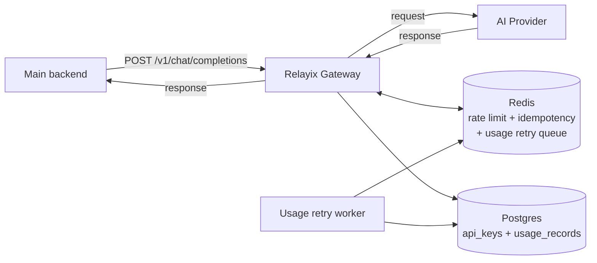

# Relayix

A FastAPI-native gateway that sits in front of your LLM providers: multi-provider routing with circuit-breaker failover, token-based cost accounting, and rate limiting.

## Overview

Relayix is a FastAPI-native gateway that sits in front of your LLM providers. Instead of application code calling OpenAI, Anthropic, or other providers directly, it calls Relayix — which handles routing between providers, fails over automatically when one is having issues, enforces rate limits, and tracks token-based cost per request.

The goal is to centralize the concerns that would otherwise be duplicated in every app that talks to an LLM: which provider to use, what to do when one goes down, how many requests a caller can make, and what everything actually costs. By moving these concerns behind a single gateway, applications stay thin and consistent, and operational policy lives in one place.

Full technical documentation — architecture, request flow, and per-module deep dives —
lives in [docs/](docs/README.md), start there.



## Features

- **Multi-provider routing** — requests are routed across configured providers based on availability and strategy.
- **Circuit-breaker failover** — unhealthy providers are automatically taken out of rotation and periodically re-tested, so an outage on one provider doesn't fail requests for your users.
- **Token-based cost accounting** — token usage and cost are recorded per request, queryable after the fact. A failed usage insert never fails the response: it is queued in Redis and a retry worker persists it.
- **Rate limiting** — requests are throttled per API key before they reach a provider, backed by Redis with an in-memory fallback if Redis is unreachable.
- **Idempotency** — send an `Idempotency-Key` header and a retried request replays the stored response instead of hitting a provider again.
- **Streaming** — `stream: true` returns the completion as Server-Sent Events.

## Tech Stack

- **Python** / **FastAPI** — async HTTP delivery layer.
- **SQLAlchemy** / **asyncpg** — ORM and persistence.
- **Alembic** — database schema migrations.
- **Redis** — rate limiting, idempotency and the usage retry queue.
- **Docker** — containerized build and deployment.
- **AWS** (ECS on EC2, RDS, ElastiCache, CloudFormation): production infrastructure.

## Running locally

```bash
cp .env.example .env       # fill in provider keys and ADMIN_API_TOKEN
poetry install
make up                    # Postgres + Redis in Docker
make run                   # migrations, then uvicorn --reload on the host
make worker                # usage retry worker, in a second terminal
```

See `Makefile` for the rest (`make test`, `make migrate`, `make revision`, ...).

## Deployment

AWS ECS on EC2 (Graviton, arm64) behind an ALB, with RDS Postgres, ElastiCache
Redis and an ADOT sidecar that ships OpenTelemetry traces to X-Ray. The
infrastructure is CloudFormation under `deploy/aws/`, releases go out through
`deploy/deploy.sh`. The full picture is in [docs/deployment.md](docs/deployment.md).

1. Create the bootstrap stack (ECR, the GitHub OIDC role, the provider keys secret):
   `aws cloudformation deploy --stack-name relayix-bootstrap --template-file deploy/aws/bootstrap.yaml --capabilities CAPABILITY_IAM`
2. Set the repo variables `AWS_REGION` and `AWS_ROLE_ARN` (the stack's `GithubActionsRoleArn` output), push to `main`, CI pushes `relayix:<sha>` to ECR.
3. Set the provider keys:
   `aws secretsmanager put-secret-value --secret-id relayix/provider-keys --secret-string '{"OPENAI_API_KEY":"...","ANTHROPIC_API_KEY":"..."}'`
4. `AWS_REGION=us-east-1 deploy/deploy.sh <sha>`, optionally with `CERTIFICATE_ARN=<acm arn>` for HTTPS. The first run creates the app stack and migrates the empty database.
5. Point the API domain at the app stack's `AlbDnsName` output.

A release is steps 2 and 4 with the new sha.

## Project Structure

```
relayix/
├── app/
│   ├── main.py            # FastAPI entrypoint: app wiring, lifespan, error handler
│   │
│   ├── api/               # HTTP delivery layer: versioned routers, schemas, deps
│   │   ├── v1/            # /v1 endpoints (chat, usage, health) + request/response schemas
│   │   └── deps.py        # shared FastAPI dependencies (auth, injected services)
│   │
│   ├── core/              # provider-agnostic business logic (no HTTP, no DB)
│   │   ├── adapters/      # per-provider clients behind one ProviderAdapter interface
│   │   ├── routing/       # tier → candidate resolution and ranking strategies
│   │   ├── resilience/    # circuit breaker and failover state
│   │   ├── ratelimit/     # per-key rate limiting
│   │   └── accounting/    # token counting, pricing tables, usage recording
│   │
│   ├── services/          # orchestration: composes core into the request pipeline
│   │
│   ├── repositories/      # persistence access for usage, api keys and pricing
│   │
│   ├── models/            # internal data models
│   │   ├── domain/        # domain dataclasses / internal models
│   │   └── db/            # ORM models
│   │
│   ├── infra/             # framework glue: config, base exceptions
│   │   ├── security/      # crypto / hashing helpers
│   │   ├── database/      # engine, session and ORM base
│   │   ├── ratelimit/     # Redis client and Redis-backed limiter
│   │   ├── idempotency/   # Redis-backed idempotency store
│   │   └── usage_queue/   # Redis-backed queue of usage inserts to retry
│   │
│   ├── workers/           # long-lived processes next to the API (usage retry)
│   │
│   └── observability/     # logging and OpenTelemetry tracing
│
├── alembic/               # migrations
├── docker/                # Dockerfile + compose stacks (dev and test)
├── deploy/                # AWS CloudFormation stacks + deploy script
├── docs/                  # architecture docs, start at docs/README.md
├── tests/                 # unit and integration suites
├── pyproject.toml
└── README.md
```

## License

This project is licensed under the MIT License.
