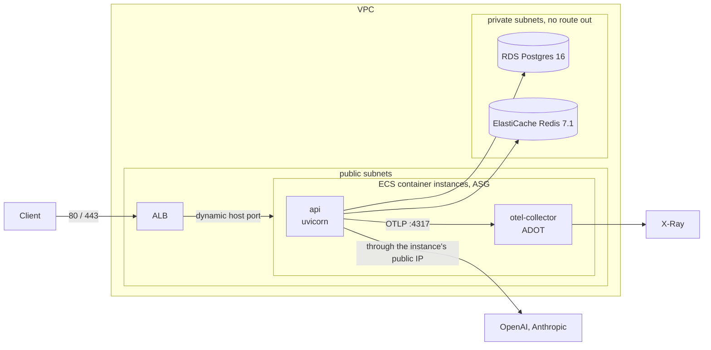
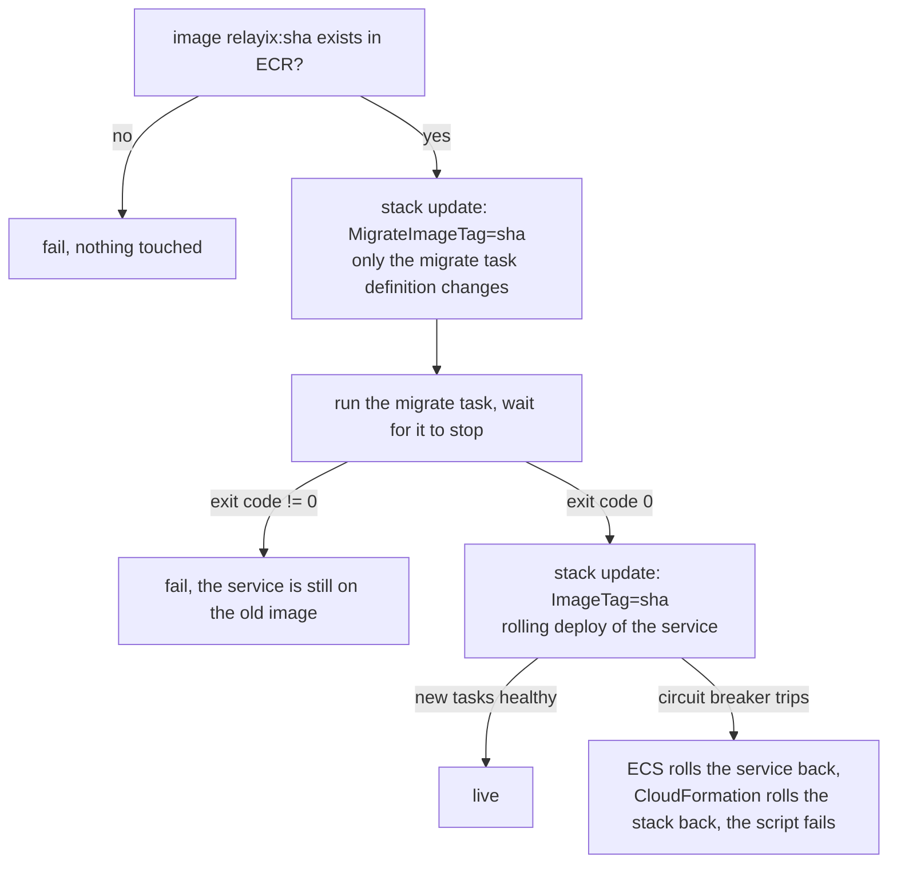

# Deployment

How Relayix runs in production: ECS on EC2 (Graviton, arm64) behind an ALB, with RDS Postgres and ElastiCache Redis in private subnets. The source of truth is [deploy/aws/bootstrap.yaml](../deploy/aws/bootstrap.yaml), [deploy/aws/app.yaml](../deploy/aws/app.yaml), [deploy/deploy.sh](../deploy/deploy.sh), [docker/Dockerfile](../docker/Dockerfile) and [docker/entrypoint.sh](../docker/entrypoint.sh); this page explains how they fit together.

## The shape



| Piece | What it is |
|---|---|
| ALB | Public, idle timeout 120s (above `PROVIDER_TIMEOUT_S`, streamed completions hold the connection), drops invalid header fields |
| Container instances | ECS-optimized Amazon Linux 2023 arm64 AMI, `t4g.medium` by default, in an autoscaling group across two AZs |
| Capacity provider | Managed scaling adds an instance when a task does not fit (a rolling deploy, a scale out), managed draining moves tasks off an instance before the ASG terminates it |
| Postgres | RDS, encrypted, 7 days of backups, not publicly accessible. Snapshot on delete or replace |
| Redis | ElastiCache, one node, TLS in transit (`rediss://`) and an auth token. No persistence: every key is a token bucket or an idempotency record with a TTL |

### Why no NAT gateway

The tasks need outbound to OpenAI, Anthropic, ECR and X-Ray. Instead of a NAT gateway, the container instances sit in public subnets with a public IP, and tasks use **bridge networking**, so their traffic goes out through the host. Nothing reaches an instance from outside: its security group admits only the ALB, on the dynamic port range (32768-65535) that bridge mode maps container port 8000 to. The ALB target group is of type `instance` for the same reason.

There is no SSH and no key pair. A shell on an instance is Session Manager:

```bash
aws ssm start-session --target <instance-id>
```

### Instance metadata

The launch template requires IMDSv2 with a hop limit of 1. The ECS agent runs on the host network and reaches it, bridge containers are one hop further and do not. A task can only use its own task role, never the instance role.

## Two stacks

| Stack | Template | Holds | Changes |
|---|---|---|---|
| `relayix-bootstrap` | `deploy/aws/bootstrap.yaml` | ECR repository, the GitHub Actions OIDC role, the `relayix/provider-keys` secret | Once, before the first image exists |
| `relayix` | `deploy/aws/app.yaml` | Network, ALB, cluster, ASG, capacity provider, task definitions, service, RDS, Redis, the generated secrets | Every release, through `deploy.sh` |

They are split because the app stack's task definition points at an image, and that image can only exist once the ECR repository does. The app stack imports the repository URI and the provider keys secret from the bootstrap stack's exports.

The ECR repository is immutable (a tag is a commit sha and never moves), scanned on push, and keeps the last 20 images, enough to roll back.

The GitHub Actions role can only be assumed from `main` of `MaximoBerth0/Relayix` through OIDC, so GitHub holds no long-lived AWS keys. Today it can only push to ECR. If the account already has the GitHub OIDC provider, create the bootstrap stack with `CreateGithubOidcProvider=false`.

## Build: CI, never the box

[.github/workflows/ci.yml](../.github/workflows/ci.yml) runs on every push to `main`: the test suite against Postgres and Redis service containers, then builds `docker/Dockerfile` on a native arm64 runner and pushes it to ECR as `relayix:<commit sha>`. It needs the repository variables `AWS_REGION` and `AWS_ROLE_ARN` (the bootstrap stack's `GithubActionsRoleArn` output).

## Tasks

### api

One task is two containers:

| Container | Does | Reservation / hard limit |
|---|---|---|
| `api` | uvicorn with `WEB_CONCURRENCY=2` | 896 CPU units, 768 MB / 1536 MB |
| `otel-collector` | ADOT with its default ECS config: receives OTLP on 4317, ships traces to X-Ray and task metrics as EMF logs | 128 CPU units, 128 MB / 256 MB |

Two tasks fit on one `t4g.medium` (2048 CPU units), which lets a rolling deploy start the new task before stopping the old one without waiting for a new instance. In bridge mode the containers do not share `localhost`, so the api reaches the collector through a link, `http://otel-collector:4317`.

The Postgres connection ceiling is `tasks × WEB_CONCURRENCY × (DB_POOL_SIZE + DB_MAX_OVERFLOW)`, `2 × (3 + 2) = 10` per task. At `MaxTasks=3`, doubled during a rolling deploy, that is 60, under what a `db.t4g.micro` allows. Raise one side only with the other in mind.

`RUN_MIGRATIONS=false`: the api never migrates on ECS, see below.

### migrate

A separate task definition, a single container running `alembic upgrade head` (the entrypoint `exec`s any command it is given). `deploy.sh` runs it as a one-off task before moving the service. It has its own image tag parameter, `MigrateImageTag`, so it can move to the new image while the service stays on the old one.

### The service

- No `DesiredCount` in the template: a new service starts at one task and autoscaling owns the count after that (CPU target tracking at 60%, between `MinTasks` and `MaxTasks`). A stack update never resets a scaled-out service.
- Rolling deploy at 100% minimum healthy and 200% maximum, with the deployment circuit breaker and rollback on.
- Tasks are spread across AZs, then binpacked by memory.
- Health check grace of 60s, ALB health check on `/health` every 15s.

## Release flow

```bash
AWS_REGION=us-east-1 deploy/deploy.sh <commit sha>
```

Optional env: `STACK_NAME` (`relayix`), `BOOTSTRAP_STACK_NAME` (`relayix-bootstrap`), `CERTIFICATE_ARN`. Parameters the script does not pass keep the stack's current value.



**The first run** finds no stack. It creates it with `RunService=false` (everything but the service and its autoscaling), migrates the empty database, then updates with `RunService=true` to create the service. Without that order the first api tasks would start against a database with no tables.

A stack that failed its first create sits in `ROLLBACK_COMPLETE` and cannot be updated: the script refuses, delete it and run again.

### Migrations and rollbacks

Migrations are never rolled back. During the rolling deploy the old image keeps serving on the new schema, and a rollback (automatic or by hand) lands the old image on it too. Keep migrations backward compatible: add in one release, drop in a later one. A release whose migration dropped or renamed something the previous code reads needs its `alembic downgrade` run by hand before rolling back.

A rollback by hand is the previous sha through the same script. Its migration step finds nothing to apply only if that image knows the current head; if the database is ahead of it, `alembic upgrade head` fails and the script stops before touching the service.

### Draining

On a deploy or a scale in, a task is deregistered from the target group and keeps its in-flight requests for 45s (above `PROVIDER_TIMEOUT_S`, so a streamed completion that started right before the drain finishes). Then ECS sends SIGTERM, `tini` forwards it, uvicorn drains for up to 25s (`--timeout-graceful-shutdown`) inside the container's 30s `stopTimeout`.

uvicorn's `--timeout-keep-alive` is 125s, above the ALB's 120s idle timeout. The other way around, uvicorn closes connections the ALB still considers open and some requests get a 502.

## Health

| Path | Checks | Exposed |
|---|---|---|
| `/health` | Liveness, the process is up, no dependencies touched | Public. The ALB health check |
| `/health/ready` | Readiness, Postgres and Redis | **Not through the ALB.** A listener rule answers 404: it names which dependency is down, which is not public information. The image's own `HEALTHCHECK` uses it, ECS ignores that one |

## HTTPS

With `CERTIFICATE_ARN` (an ACM certificate in the stack's region), the ALB serves HTTPS on 443 with `ELBSecurityPolicy-TLS13-1-2-2021-06` and 80 redirects to it. Without it, the ALB serves plain HTTP on 80. Set it on any run of `deploy.sh`, the stack keeps it afterwards. Then point the API domain (CNAME or alias) at the `AlbDnsName` output.

## Configuration and secrets

Every `Settings` field in [app/infra/config.py](../app/infra/config.py) reaches the api container as an environment variable. Plain values are set in the task definition (`ENVIRONMENT=production`, `DB_SSL=require`, pool sizes, OTel). Secrets are resolved by the execution role when the task starts:

| Secret | Holds | Created by |
|---|---|---|
| `relayix/provider-keys` | JSON with `OPENAI_API_KEY` and `ANTHROPIC_API_KEY` | Bootstrap stack, empty values. Set by hand |
| `relayix/connection-urls` | JSON with `DATABASE_URL` and `REDIS_URL` | App stack, built from the generated passwords and the RDS and Redis endpoints |
| `relayix/admin-api-token` | `ADMIN_API_TOKEN` | App stack, generated |
| `relayix/db-password`, `relayix/redis-auth` | The generated Postgres password and Redis auth token | App stack, only read by CloudFormation to build the above |

Set the provider keys with:

```bash
aws secretsmanager put-secret-value --secret-id relayix/provider-keys \
    --secret-string '{"OPENAI_API_KEY":"sk-...","ANTHROPIC_API_KEY":"sk-ant-..."}'
```

Both keys must stay in the JSON, ECS refuses to start a task when one is missing. An empty value just leaves that provider unregistered. CloudFormation never rewrites the value while the template's placeholder stays the same. Secrets are read when a task starts, so a new key reaches running tasks only after they are replaced:

```bash
aws ecs update-service --cluster relayix --service relayix-api --force-new-deployment
```

Read the admin token with:

```bash
aws secretsmanager get-secret-value --secret-id relayix/admin-api-token --query SecretString --output text
```

## Operations

**Logs**: CloudWatch, `/ecs/relayix/api`, `/ecs/relayix/otel-collector` and `/ecs/relayix/migrate`, 14 days by default (`LogRetentionDays`). Container Insights is on for the cluster.

**AMI updates**: the AMI comes from the SSM parameter for the latest ECS-optimized AL2023 arm64 image, re-resolved on every stack update. A new AMI only reaches new instances, replace the running ones with an instance refresh:

```bash
aws autoscaling start-instance-refresh --auto-scaling-group-name <asg name>
```

Managed draining moves the tasks off each instance before it goes.

**Deleting the stack**: `DbDeletionProtection` defaults to `true`, so the delete fails until it is set to `false` with a stack update. RDS then leaves a final snapshot. The bootstrap stack can only be deleted after the app stack (it holds the exports) and once its ECR repository is empty.

## Stack parameters

| Parameter | Default | Notes |
|---|---|---|
| `ImageTag` | (required) | The commit sha the service runs |
| `MigrateImageTag` | empty | Empty means `ImageTag`. Moved ahead of it by `deploy.sh` |
| `RunService` | `true` | `false` only on the first create |
| `CertificateArn` | empty | Empty serves HTTP only |
| `InstanceType` | `t4g.medium` | arm64 only, the image is `linux/arm64` |
| `MinInstances` / `MaxInstances` | 1 / 3 | |
| `MinTasks` / `MaxTasks` | 1 / 3 | Autoscaling bounds of the service |
| `AdotImage` | `aws-otel-collector:v0.40.0` | Pinned, bump on purpose |
| `DbInstanceClass` / `DbAllocatedStorage` | `db.t4g.micro` / 20 GB | |
| `DbDeletionProtection` | `true` | |
| `RedisNodeType` | `cache.t4g.micro` | |
| `LogRetentionDays` | 14 | |
