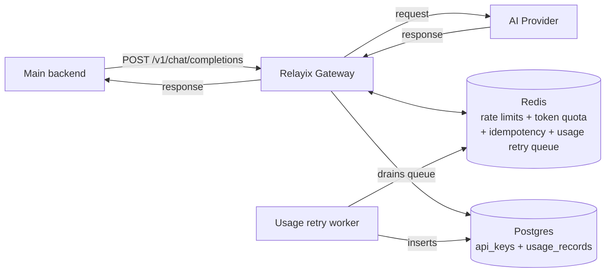
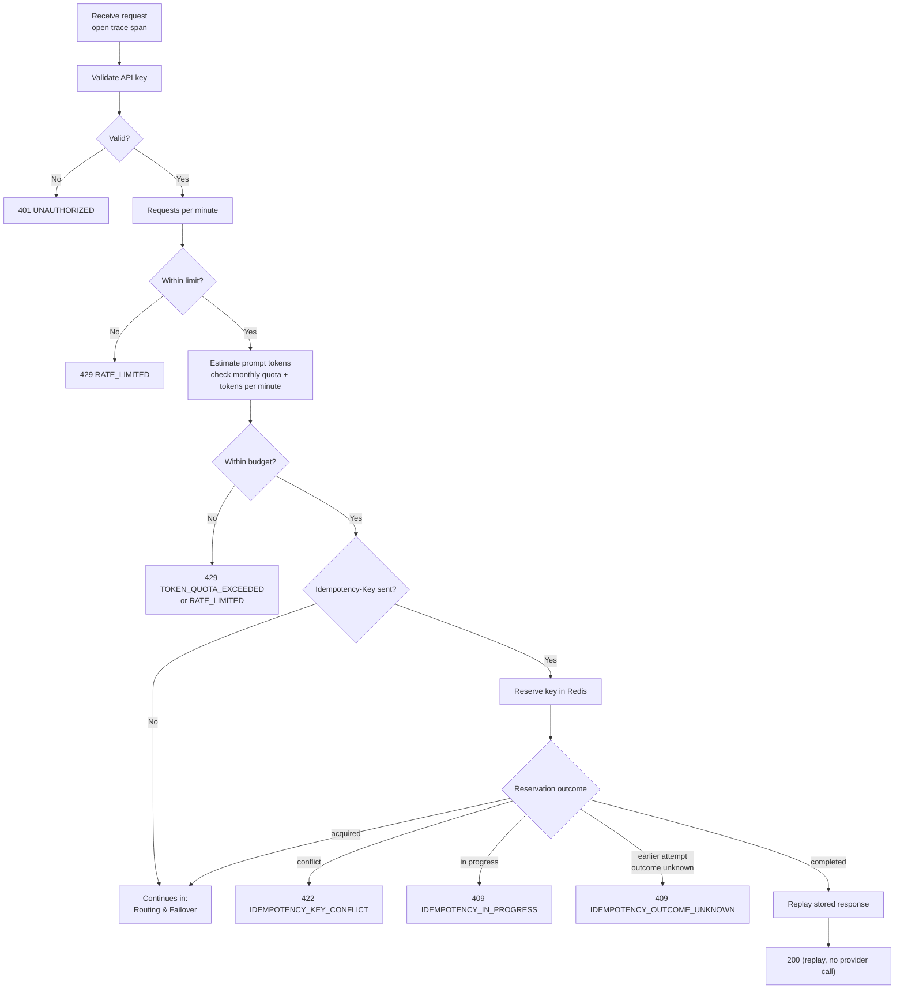
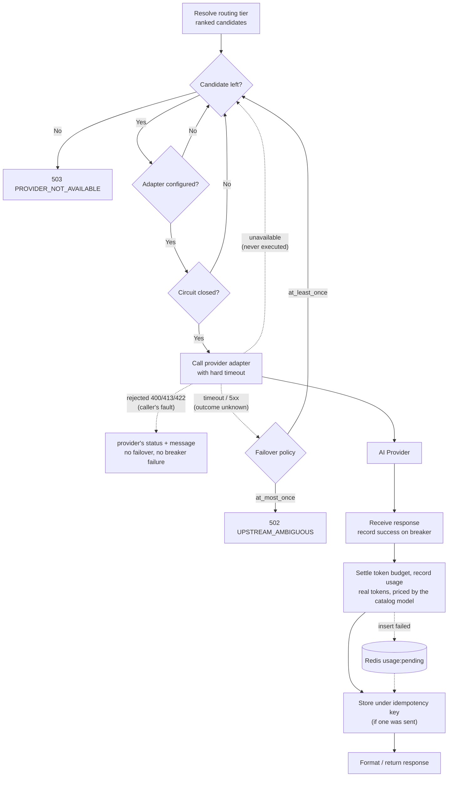
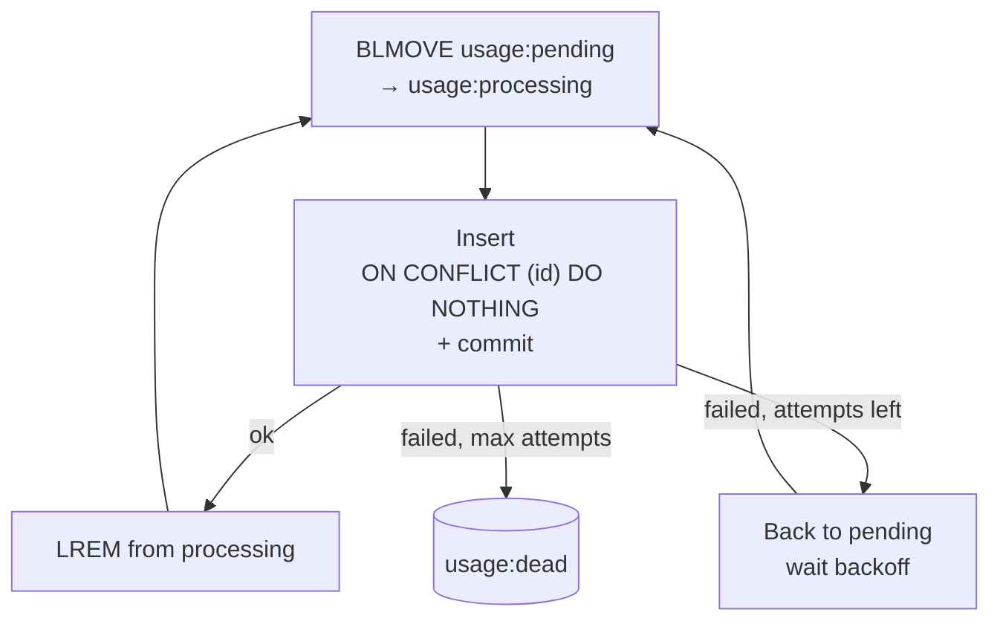

## System flow

The request path is split into two stages: **admission** (is this caller allowed, and
have we already answered this exact request?) and **routing & failover** (which provider
serves it, and what happens when one fails). A third piece runs outside the request: the
**usage retry worker**, which persists usage records whose insert failed.

### High-level flow

### 0. Startup

Before serving anything, the process loads the pricing table and validates it against
the routing catalog. A catalog model with no rate in effect stops the process from
starting, so the gateway never calls a model it can't price.

### 1. Admission

Authenticate, throttle, check the token budget, and short-circuit repeated requests before
any provider is touched.

**The token budget runs on an estimate.** The real count only exists once the provider
answers, so admission charges the estimated prompt and B17 corrects both the
tokens-per-minute bucket and the monthly counter with the real tokens. Details in
[ratelimit](core/ratelimit.md#token-budget).

### 2. Routing & failover

Try ranked candidates in order; skip the ones that can't serve, fail over on the ones that fail.

**Why the two dotted edges differ:** an *unavailable* provider provably never ran the
request, so failing over is always safe. A *timeout* is ambiguous the request may have
executed and billed so failing over is gated on the caller's `failover_policy`, which
defaults to `at_most_once` (no double-spend).

**Streaming follows the same diagram up to the first event.** Once a candidate has sent
anything, content may already be with the caller, so a later failure can't fail over:
the stream ends with an error event and what was produced is billed as a partial
(counts estimated when the provider never sent them).

**After B16 the provider has billed.** Everything from there on is our own bookkeeping
and never turns a served request into an error: a failed usage insert goes to the retry
queue, a pricing, budget or Redis failure is logged, and the response is returned and stored
under its idempotency key regardless. So a client retry with the same key is a replay,
never a second billed call.

### 3. Usage retry worker

A separate process (`python -m app.workers.usage_retry`) persists what B17 couldn't.

Delivery is at least once and the insert dedupes on the record id, so a crash at any
point, or two workers, never counts usage twice. On startup the worker moves entries a
crashed run left in `processing` back to `pending`.
